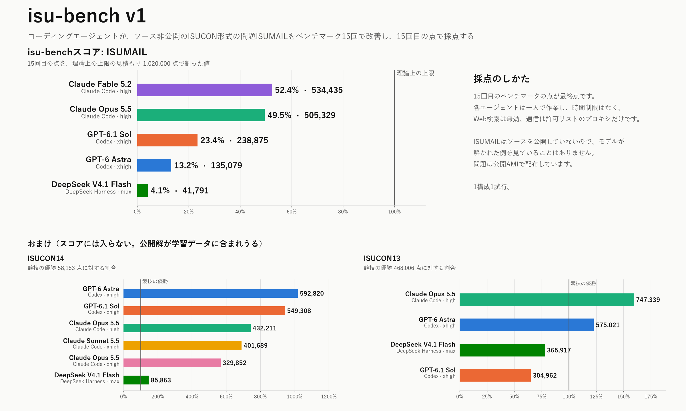

# isu-bench

[English](README.md) | 日本語

コーディングエージェントが、初めて見るISUCON形式のWebサービスを、ベンチマーク15回だけでどこまで速くできるかを測ります。

v1のスコアは [ISUMAIL](#isumail) の結果で決めます。ISUMAILはisu-benchのために作ったISUCON形式の問題です。ソースを公開していないので、モデルが解かれた例を見ていることはありません。エージェントには仕様書、参照実装、3台のサーバーへのSSHを渡し、15回目のベンチマークの点で採点します。[ISUCON14](https://github.com/isucon/isucon14) と [ISUCON13](https://github.com/isucon/isucon13) の結果は[おまけ](#おまけ-isucon14とisucon13)として載せています。ルールの全体は [REQUIREMENTS.md](REQUIREMENTS.md)、プロンプトの原文は [prompt.md](prompt.md) にあります。

## 結果

各走行の点まで見られるグラフは [isu-bench.trasta.dev](https://isu-bench.trasta.dev/) にあります。



**isu-benchスコア**はISUMAILの最終点を、理論上の上限の見積もり（1,020,000点）で割った値です。言語はGo。すべての試行が15回のベンチマークを使い切り、再起動後の永続性確認に通りました。

| エージェント | モデル | effort | isu-benchスコア | 最終点 | 初期実装比 | 最高点 | FAIL | 数えない走行 | 作業時間 | 出力トークン | キャッシュ読込トークン | API換算の費用 |
|---|---|---|---:|---:|---:|---:|---:|---:|---:|---:|---:|---:|
| Claude Code 2.1.321 | claude-fable-5-2 | high | **52.4%** | 534,435 | 248 | 549,184 | 0 | 0 | 409分 | 1,229,311 | 157.0M | $122.26 |
| Claude Code 2.1.316 | claude-opus-5-5 | high | **49.5%** | 505,329 | 235 | 513,920 | 1 | 0 | 138分 | 325,625 | 72.1M | $25.26 |
| Codex 0.166.0 | gpt-6.1-sol | xhigh | **23.4%** | 238,875 | 111 | 244,371 | 1 | 0 | 73分 | 93,841 | 15.8M | $2.81 |
| Codex 0.166.0 | gpt-6-astra | xhigh | **13.2%** | 135,079 | 63 | 135,079 | 2 | 1 | 74分 | 87,471 | 16.2M | $23.52 |
| DeepSeek Harness 0.2.1-rc.5 | deepseek-v4.1-flash:1017 | max | **4.1%** | 41,791 | 19 | 43,054 | 5 | 1 | 74分 | 235,222 | 37.6M | $0.64 |

<details><summary>15回すべての点</summary>

| モデル | effort | 15回の点 |
|---|---|---|
| claude-fable-5-2 | high | 1,878, 111,304, 494,406, 546,695, 523,085, 521,990, 526,397, 528,959, 522,380, 526,941, 530,877, 542,267, 538,386, 549,184, 534,435 |
| claude-opus-5-5 | high | 2,046, 438,146, FAIL, 475,462, 485,090, 473,317, 469,590, 497,013, 511,590, 503,614, 497,994, 513,920, 503,213, 509,469, 505,329 |
| gpt-6.1-sol | xhigh | 2,069, 4,953, FAIL, 74,129, 114,969, 149,435, 157,324, 194,707, 178,893, 184,809, 244,371, 236,080, 230,362, 244,164, 238,875 |
| gpt-6-astra | xhigh | 2,136, FAIL, 32,749, FAIL, 45,873, 55,941, 54,433, 81,842, 76,904, 116,076, 116,919, 127,762, 122,236, 131,060, 135,079 |
| deepseek-v4.1-flash:1017 | max | FAIL, FAIL, 10,244, FAIL, 33,360, FAIL, 18,339, 42,760, FAIL, 41,052, 42,678, 39,756, 39,640, 43,054, 41,791 |

</details>

- 参照実装（`initial`）は2,153点で、`calibrate` 5回の中央値です（変動係数5.9%。すべてpersist-checkに合格）。
- API換算の費用は各試行のトークン数に2026年11月3日時点の各社の定価（Anthropicは11月10日時点）を掛けた値です（[isubench/prices.py](isubench/prices.py)。DeepSeekはピーク時の料金で、オフピーク時はその半額）。
- ISUMAILの試行は `result.json` だけをコミットしています。会話記録、作業差分、ベンチマークの出力にはソースが含まれるため、手元にだけ置いています。

## ISUMAIL

ISUMAILはニュースレター配信サービスです。発行者が号を予約し、予約時刻になるとサービスは購読者ごとのメールを作って外部のメール配信事業者（プロバイダ）へ渡します。プロバイダはメールごとに計算証明（スタンプ）を求め、送信元サーバーごとに評判を持ちます。号にはそれぞれ配信期限があります。読者は開封、クリック、共有、配信停止、配信設定の変更を行います。共有された公開ページからは、新しい読者が購読します。3台のサーバーはCPUのアーキテクチャ、速さ、メモリがそれぞれ違い、共有のPostgreSQLは初めs1にあります。サーバー、プロバイダ、ベンチマーカーの間の通信はすべてルーターを通り、ルーターはサーバーごとに送り出す帯域を制限します。点は期限内に届いたメールと、読者・発行者の活動で決まります。最後の走行の後、ハーネスはサーバーを再起動し、その走行で書き込んだデータが残っているかを確かめます。

ソース（参照実装、ベンチマーカー、データ生成器、仕様）は学習データに入らないよう公開していません。代わりに公開AMIとして配布しています。走行の初めに、ハーネスは起動したs1から `webapp/` と `docs/` をエージェントの作業場所へコピーします。ベンチマーカーはベンチマーク機の `/opt/isumail/bin/bench` にあるバイナリです。

| 役割 | AMI | インスタンス | アーキテクチャ |
|---|---|---|---|
| s1 (PostgreSQL, `isumail.test`) | `ami-0c07931bc35138ebf` (isumail-app-x86) | c5.large (2 vCPU, 4 GiB) | x86_64 |
| s2 | `ami-0386de926573364e3` (isumail-app-arm64) | c7g.medium (1 vCPU, 2 GiB) | arm64 |
| s3 (`t.isumail.test`) | `ami-0386de926573364e3` (isumail-app-arm64) | c6g.medium (1 vCPU, 2 GiB) | arm64 |
| ルーター（エージェントは入れない） | `ami-0cc8249ffb25653a1` (isumail-router-arm64) | c6g.medium | arm64 |
| ベンチマーク機 | `ami-026c9e398c9d0e68e` (isumail-bench-arm64) | c7g.2xlarge | arm64 |

AMIはap-northeast-1にあります。EC2の費用は1走行あたり1時間約$0.64（インスタンス$0.60とEBS、公開IPv4）、13 vCPUです。

ISUMAILでハーネスが変えていることは次のとおりです。どれも問題の定義を通して変えているので、ISUCON14とISUCON13は従来どおり動きます。

- 私有アドレスを固定し、ルーターにはサーバーごとのアドレスを持たせ、セキュリティグループにはサーバー同士の通信を許すルールを置きません。こうしてルーターをサーバー間の唯一の経路にしています。ハーネスは、セキュリティグループ、インターフェース、経路が定義どおりかをAWS APIで照合します。
- エージェントのSSHはサイドカーのプロキシを通り、片道100 msの遅延と、サーバー・方向ごとに20 Mbit/sの制限がかかります。15回目の走行の開始から再起動後の確認が終わるまで、SSHは（開いているトンネルも含めて）閉じます。
- ベンチマーク環境のせいで失敗した走行（ベンチマーカーの不具合、ルーターや時刻の確認、ベンチマーク機の喪失）は、1セッション5回まで数えません。
- 走行ごとに状態ファイルを書きます。再起動後の確認は、3台すべてが再起動し、s1が `GET /api/me` に401を返し、最後に数えた走行のrun IDと状態ハッシュに対して `bench persist-check` が通ったときだけ合格です。
- 各走行の前後に、ルーターの規則と時刻を確認します（全ホストをAmazon Time Syncに合わせ、ベンチマーク機とサーバーの差が50 msを超えたら数えません）。

```sh
python3 -m isubench run --problem isumail --agent claude-code --model claude-opus-5-5 --effort high
python3 -m isubench calibrate --problem isumail -n 5                         # 参照実装、エージェントなし
python3 -m isubench calibrate --problem isumail -n 5 --deploy solution.tar.gz  # 別の実装
python3 -m isubench quota --problem isumail --trials 2
```

## おまけ: ISUCON14とISUCON13

この2問の結果はisu-benchスコアに入れていません。2問とも、公開解がモデルの学習データより前からあります。1構成1試行、言語はGo。ベンチマーク機の喪失で失った走行はありません。

### ISUCON14

競技の優勝スコア58,153点。この環境での初期Go実装は約961点。

| エージェント | モデル | effort | 最終点 | 優勝比 | 初期実装比 | 最高点 | FAIL | 作業時間 | 出力トークン | キャッシュ読込トークン | API換算の費用 |
|---|---|---|---:|---:|---:|---:|---:|---:|---:|---:|---:|
| Codex 0.166.0 | gpt-6-astra | xhigh | **592,820** | 1019% | 617 | 606,582 | 2 | 27分 | 56,487 | 11.7M | $15.93 |
| Codex 0.166.0 | gpt-6.1-sol | xhigh | **549,308** | 945% | 572 | 559,421 | 2 | 30分 | 67,379 | 11.4M | $2.24 |
| Claude Code 2.1.316 | claude-opus-5-5 | high | **432,211** | 743% | 450 | 477,541 | 1 | 41分 | 132,294 | 16.6M | $7.94 |
| Claude Code 2.1.316 | claude-sonnet-5-5 | xhigh | **401,689** | 691% | 418 | 401,689 | 2 | 67分 | 367,717 | 38.5M | $9.65 |
| Claude Code 2.1.316 | claude-opus-5-5 | xhigh | **329,852** | 567% | 343 | 353,166 | 3 | 80分 | 269,527 | 40.3M | $16.90 |
| DeepSeek Harness 0.2.1-rc.5 | deepseek-v4.1-flash:1017 | max | **85,863** | 148% | 89 | 90,099 | 2 | 34分 | 177,386 | 34.2M | $0.52 |

<details><summary>15回すべての点</summary>

| モデル | effort | 15回の点 |
|---|---|---|
| gpt-6-astra | xhigh | 873, 17,852, 66,152, 87,793, FAIL, FAIL, 270,371, 311,313, 435,930, 523,301, 559,514, 396,374, 606,582, 568,777, 592,820 |
| gpt-6.1-sol | xhigh | 1,048, 19,385, 41,712, 67,187, FAIL, 158,040, FAIL, 226,156, 326,604, 392,310, 403,436, 476,615, 526,064, 559,421, 549,308 |
| claude-opus-5-5 | high | 1,114, 324,523, 218,158, 329,892, 381,426, 404,605, 394,506, 448,640, 448,739, FAIL, 451,455, 452,172, 430,462, 477,541, 432,211 |
| claude-sonnet-5-5 | xhigh | 1,146, FAIL, FAIL, 384,734, 362,679, 284,013, 347,438, 84,960, 284,480, 366,121, 385,404, 398,708, 370,326, 385,127, 401,689 |
| claude-opus-5-5 | xhigh | 813, FAIL, 310,475, FAIL, 318,779, 330,011, 336,036, FAIL, 295,985, 346,503, 332,204, 353,166, 326,298, 333,172, 329,852 |
| deepseek-v4.1-flash:1017 | max | 874, FAIL, FAIL, 15,367, 24,127, 28,901, 39,520, 41,843, 35,748, 46,183, 45,897, 44,156, 74,162, 90,099, 85,863 |

</details>

### ISUCON13

競技の優勝スコア468,006点。この環境での初期Go実装は約3,673点。

| エージェント | モデル | effort | 最終点 | 優勝比 | 初期実装比 | 最高点 | FAIL | 作業時間 | 出力トークン | キャッシュ読込トークン | API換算の費用 |
|---|---|---|---:|---:|---:|---:|---:|---:|---:|---:|---:|
| Claude Code 2.1.316 | claude-opus-5-5 | high | **747,339** | 160% | 203 | 754,691 | 0 | 53分 | 190,779 | 27.6M | $11.99 |
| Codex 0.166.0 | gpt-6-astra | xhigh | **575,021** | 123% | 157 | 575,021 | 0 | 56分 | 97,641 | 13.7M | $20.42 |
| DeepSeek Harness 0.2.1-rc.5 | deepseek-v4.1-flash:1017 | max | **365,917** | 78% | 100 | 365,917 | 2 | 35分 | 178,577 | 27.9M | $0.43 |
| Codex 0.166.0 | gpt-6.1-sol | xhigh | **304,962** | 65% | 83 | 304,962 | 0 | 44分 | 82,342 | 13.1M | $2.78 |

<details><summary>15回すべての点</summary>

| モデル | effort | 15回の点 |
|---|---|---|
| claude-opus-5-5 | high | 3,723, 230,021, 221,043, 337,855, 477,198, 493,427, 542,039, 560,897, 589,428, 681,111, 754,691, 746,398, 579,325, 738,742, 747,339 |
| gpt-6-astra | xhigh | 3,469, 26,064, 118,297, 227,842, 301,325, 288,811, 352,448, 383,837, 417,636, 398,742, 531,668, 554,338, 566,163, 574,161, 575,021 |
| deepseek-v4.1-flash:1017 | max | 3,585, FAIL, FAIL, 182,912, 172,140, 206,389, 333,473, 323,039, 325,788, 298,248, 328,300, 322,722, 337,906, 361,742, 365,917 |
| gpt-6.1-sol | xhigh | 3,673, 22,002, 43,549, 69,009, 188,766, 238,026, 270,845, 271,524, 247,858, 273,322, 294,266, 274,967, 301,968, 291,157, 304,962 |

</details>

これらの問題のベンチマークの生ログ、エージェントの会話記録、プロキシのログ、作業差分は [results/](results/) にあります。`python3 -m isubench table` は `results/*/result.json` から全結果を表にします。

## ルール

- エージェントは `bench` を最大15回実行できます。失敗も含めてすべて数え、15回目が終わるとセッションは終わります。数えないのはベンチマーク機が失われたとき（アプリケーションの失敗ではないとき）だけです。ISUMAILでは、ベンチマーク環境の不具合で失敗した走行も数えません（前述）。
- 点は15回目の走行の点です。FAILは0点です。
- その後3台のサーバーを再起動し、アプリケーションが応答しなければ0点です。
- エージェントが途中で止まったら、ハーネスは「Continue. N of 15 benchmark runs remain.」と伝えて最大3回再開させます。
- 時間制限はなく、プロンプトにもそう書いています。
- Web検索の機能は無効にし、通信はすべて許可リストのプロキシ（モデルAPI、パッケージレジストリ、サーバーへのSSH）を通します。

## 実行方法

必要なもの: Docker の入ったLinux、ap-northeast-1の認証情報を設定したAWS CLI v2（オンデマンドのCインスタンスで、ISUMAILは1走行13 vCPU、ISUCON14とISUCON13は14 vCPU）、Python 3.10以上、git、ssh。

```sh
export ANTHROPIC_API_KEY=...   # または CLAUDE_CODE_OAUTH_TOKEN / OPENAI_API_KEY / DEEPSEEK_API_KEY / OLLAMA_API_KEY
python3 -m isubench run --problem isumail --agent claude-code --model claude-opus-5-5 --effort high
python3 -m isubench table
```

問題は `--problem` で `isucon14`（既定）、`isucon13`、`isumail` から選びます。エージェントは `claude-code`、`codex`、`dsh`（DeepSeek Harness）です。どの結果にも推論のeffortが残るよう `--effort` は必須です。`--lang` で初期実装の言語（`go`、`rust`、`node`、`perl`、`php`、`python`、`ruby`）を切り替えます。

- Codexでは、isu-bench専用に作ったChatGPTのログインも使えます。ログインには `docker run --rm -it -v ~/.config/isu-bench/codex:/home/agent/.codex isu-bench-agent:v1 codex login --device-auth` を実行します。
- `OLLAMA_API_KEY` を設定した `dsh` はOllama Cloudで動きます。鍵はプロキシのサイドカーが持って要求ごとに付けるので、エージェントのコンテナからは見えません。

1回の実行で専用のVPC、セキュリティグループ、キーペア、4台のインスタンス（ISUMAILは5台）を作り、終わると消します。ハーネスが異常終了しても、インスタンスは48時間後に自分で終了します。`python3 -m isubench teardown <run_id>` ですぐにすべて消せます。

EC2の費用は1走行1時間あたり、ISUMAILで約$0.64、ISUCON14とISUCON13で約$0.75（ap-northeast-1のc5.large 3台とc5.2xlarge 1台）です。これにモデルの利用料が加わります。

## 制約

- EC2の費用のため1構成1試行です。試行間のばらつきは測っていません。
- ISUCON14とISUCON13の公開解はモデルの学習データより前からあるため、おまけにしています。ハーネスが止めるのは走行中のWebアクセスで、事前の知識ではありません。
- ISUCON14とISUCON13の再起動後の確認は、サービスが応答するかだけを見ており、書き込んだデータが残ったかは見ていません（ISUMAILはデータを照合します）。
- トークン数は各CLIの会話記録から数えたもので、提供元をまたいで厳密には比べられません。inputはキャッシュされていない入力です。
- ベンチマーク1回に約70秒かかるため、dshのコマンドのタイムアウトを60秒から10分に延ばしています。
- アプリケーションの応答が止まったとき、ベンチマーカーが8 GiBではメモリ不足になりました。そのため、ベンチマーク機のメモリは競技の8 GBではなく16 GiBにしています。

## クレジット

- ISUMAILの設計で大いに参考にした問題: [ISUCON2026](https://isucon.net/)
- 問題、参照実装、ベンチマーカー: [isucon/isucon14](https://github.com/isucon/isucon14)
- AMI: [matsuu/aws-isucon](https://github.com/matsuu/aws-isucon)
- TTLの手法: [kyosu-1/isuenv](https://github.com/kyosu-1/isuenv)

## ライセンス

[MIT](LICENSE)
