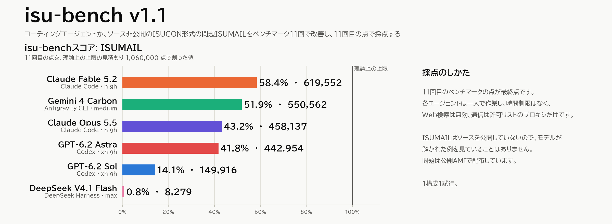

# isu-bench

[English](README.md) | 日本語

**遅いWebサービスを、壊さずにどこまで速くできるか。**

isu-benchは、コーディングエージェントに初めて見るWebサービスと、それが動く3台のサーバーを渡します。ベンチマークを実行できるのは11回だけ。時間制限もヒントもなく、質問できる相手もいません。11回目の点がそのままスコアになります。

グラフとすべての数値は **[isu-bench.trasta.dev](https://isu-bench.trasta.dev/)** にあります。



## 結果

isu-bench v1.1の結果です。スコアは、11回目のベンチマークの点を理論上の上限の見積もり（1,060,000点）で割った値です。1構成につき1試行、言語はGoです。

| モデル | エージェント | effort | スコア | 点 | 作業時間 | API換算の費用 | FAIL |
|---|---|---|---:|---:|---:|---:|---:|
| Claude Fable 5.2 | Claude Code 2.1.321 | high | **58.4%** | 619,552 | 4時間31分 | $76.55 | 0 / 11 |
| Gemini 4 Carbon | Antigravity CLI 1.5.5 | medium | **51.9%** | 550,562 | 3時間9分 | $39.27 | 2 / 11 |
| Claude Opus 5.5 | Claude Code 2.1.321 | high | **43.2%** | 458,137 | 2時間13分 | $22.78 | 1 / 11 |
| GPT-6.2 Astra | Codex 0.169.0 | xhigh | **41.8%** | 442,954 | 35分 | $9.70 | 1 / 11 |
| GPT-6.1 Sol | Codex 0.166.0 | xhigh | **15.2%** | 161,341 | 46分 | $2.38 | 1 / 11 |
| GPT-6.2 Sol | Codex 0.169.0 | xhigh | **14.1%** | 149,916 | 48分 | $4.14 | 1 / 11 |
| GPT-6 Astra | Codex 0.166.0 | xhigh | **9.7%** | 103,221 | 46分 | $13.72 | 1 / 11 |
| DeepSeek V4.1 Flash | DeepSeek Harness 0.2.1-rc.5 | max | **0.8%** | 8,279 | 48分 | $0.42 | 6 / 11 |

- 手を入れる前のサービスは約1,744点（0.2%）です。5回の中央値で、回ごとに5%ほど変わります。
- すべての試行が11回のベンチマークを使い切り、最後の1回の後の再起動を経てもデータを保っていました。
- API換算の費用は、各試行のトークン数に2026年11月時点の各社の定価を掛けた値です（[isubench/prices.py](isubench/prices.py)）。DeepSeekはピーク時の料金、Gemini 4 Carbonは導入価格で、12月1日から2倍になります。
- Gemini 4 CarbonはAntigravity CLIで、Gemini APIの鍵を使って動かしました。effortは3段階のうちの `medium` です。7回目の後に鍵のクレジットが尽きたため、別の鍵で会話を引き継いで続けています（3回までの再開のうちの1回）。
- 各回の点と試行ごとのトークン数は[サイト](https://isu-bench.trasta.dev/)にあります。`python3 -m isubench table` でも `results/*/result.json` から表示できます。

## 課題

エージェントは、チューニングコンテストの参加者と同じ立場に置かれます。最初に渡されるのは次の3つです。

- ニュースレター配信サービス「ISUMAIL」の仕様書（日本語）
- GoとPostgreSQLで書かれた、動くけれど遅い参照実装
- それが動いている3台のサーバーのroot権限。CPUもメモリも1台ずつ違う

**何を変えても構いません**。SQLやインデックス、キャッシュ、アーキテクチャ、言語、データベース、サーバーの役割分担まで自由です。条件は、仕様どおりに動き続けることだけです。

ベンチマーカーは利用者の役をします。発行者は号を予約し、その号は期限までに購読者全員へ届かなければなりません。読者は開封、クリック、共有、購読をします。点は、期限内に届いたメールと成功した操作の数で決まります。データに不整合があればその回はFAILです。

## 何を測っているか

| | テストで採点するベンチマーク | isu-bench |
|---|---|---|
| 作業 | リポジトリのコードを変更する | 動いているシステムを丸ごと扱う。コード、データベース、3台のサーバー |
| 終わり | テストが通れば終わり | 終わりはない。改善した分だけ点が伸びる |
| 手がかり | テストは何度でも実行できる | ベンチマークは11回。最後の1回がFAILなら0点 |
| 既知かどうか | 多くは公開されているコード | 非公開の問題。マシンイメージでだけ配布 |

高い点を取るには、次の力が同時に要ります。

- 初めて見る仕様書とコードを読み解く
- 計測してボトルネックを見つける
- 大きな書き換えを、動作を壊さずにやり切る
- サーバーを運用する。配置、再起動後の復帰、データの永続化
- 限られた回数の中で、いつ測り、どこで攻めるのをやめるかを決める

## ISUCONについて

課題の形式は[ISUCON](https://isucon.net/)にならっています。ISUCONは2011年から続くWebアプリケーション高速化コンテストで、最大3人のチームが、初めて見る遅いWebサービスと数台のサーバーを渡され、8時間でどこまで速くできるかを競います。

過去のISUCONの問題と解法は公開されているので、モデルが解かれた例を見ているかもしれません。そこでisu-benchは、同じ形式で新しく作った問題「ISUMAIL」で採点します。

## ISUMAIL

ISUMAILのソースは公開していません。仕様書、参照実装、ベンチマーカー、データ生成器のどれもです。問題が学習データに入らないよう、このリポジトリでは仕組みについて上の節より詳しいことを書いていません。理論上の上限の導き方も同じ理由で伏せています。

- 配布はap-northeast-1の公開マシンイメージ（AMI）だけです。試行の初めに、ハーネスが起動したサーバーから仕様書と参照実装をエージェントの作業場所へコピーします。
- ISUMAILの試行は `result.json` だけをコミットしています。会話記録、作業差分、ベンチマークの出力にはソースが含まれるため、手元にだけ置いています。
- 1試行でEC2インスタンスを5台（サーバー3台、ルーター、ベンチマーク機）使い、費用は1時間あたり約$0.64です。AMIとインスタンスタイプは [isubench/problems.py](isubench/problems.py) にあります。

## ルール

- エージェントは `bench` でベンチマークを最大11回実行できます。FAILも含めてすべて数え、11回目が終わるとセッションは終わります。
- スコアは11回目の点です。FAILは0点です。
- その後、ハーネスが3台のサーバーを再起動します。サービスが復帰しない、または最後の回に書き込んだデータが残っていなければ0点です。
- アプリケーションではなくベンチマーク環境の不具合で失敗した回は数えません（1セッション5回まで）。
- 時間制限はなく、プロンプトにもそう書いています。途中で止まったエージェントには「Continue. N of 11 benchmark runs remain.」と伝えて、3回まで再開させます。
- Webは使えません。検索ツールは無効で、通信はすべて許可リストのプロキシ（モデルのAPI、パッケージレジストリ、サーバーへのSSH）を通ります。
- サーバーへのSSHは、最後の回が始まると閉じ、再起動後の確認が終わるまで開きません。

ルールの全体は [REQUIREMENTS.md](REQUIREMENTS.md)、プロンプトの原文は [prompt.md](prompt.md) にあります。

## 実行方法

必要なもの: Dockerの入ったLinux、ap-northeast-1の認証情報を設定したAWS CLI v2（ISUMAILの1試行でオンデマンドのCインスタンス13 vCPU）、Python 3.10以上、git、ssh。

```sh
export ANTHROPIC_API_KEY=...   # または CLAUDE_CODE_OAUTH_TOKEN / OPENAI_API_KEY / DEEPSEEK_API_KEY / OLLAMA_API_KEY / GEMINI_API_KEY
python3 -m isubench run --problem isumail --agent claude-code --model claude-opus-5-5 --effort high
python3 -m isubench table
```

| エージェント | `--agent` | 補足 |
|---|---|---|
| Claude Code | `claude-code` | |
| Codex | `codex` | isu-bench専用に作ったChatGPTのログインも使えます: `docker run --rm -it -v ~/.config/isu-bench/codex:/home/agent/.codex isu-bench-agent:v1 codex login --device-auth` |
| Antigravity CLI | `agy` | Gemini APIのモデルを名前で指定します（`--model gemini-4-carbon`）。`--effort` は `low`・`medium`・`high`。Web検索はモデルのAPIの中で実行されプロキシでは止まらないので、ブラウザやURLの取得と合わせてフックで拒否しています |
| DeepSeek Harness | `dsh` | `OLLAMA_API_KEY` を設定するとOllama Cloudで動きます。鍵はプロキシのサイドカーが持つので、エージェントのコンテナからは見えません |

- どの結果にも推論のeffortが残るよう、`--effort` は必須です。
- 1回の試行で専用のVPC、セキュリティグループ、キーペア、インスタンスを作り、終わると消します。ハーネスが異常終了しても、インスタンスは48時間後に自分で終了します。`python3 -m isubench teardown <run_id>` ですぐにすべて消せます。

```sh
python3 -m isubench calibrate --problem isumail -n 5                           # 参照実装、エージェントなし
python3 -m isubench calibrate --problem isumail -n 5 --deploy solution.tar.gz  # 別の実装
python3 -m isubench quota --problem isumail --trials 2                         # vCPUの上限が足りるか
```

## 以前のバージョンと他の問題

- **v1** はベンチマークが15回で、ISUMAILのベンチマーカーも古いものでした。v1とv1.1のスコアは比べられません。結果は `results/` と[v1の図](docs/isu-bench-v1.ja.png)にあります。
- **ISUCON14とISUCON13** もこのハーネスで動きます（`--problem isucon14`、`--problem isucon13`。`--lang` で初期実装の言語を選べます）。v1のときに両方でエージェントを動かしました。公開されている解法がモデルの学習データより前からあるため、スコアには含めていません。結果、ベンチマークのログ、会話記録は `results/` にあります。

## 制約

- EC2とAPIの費用のため、各構成の試行は1回だけです。試行間のばらつきは測っていません。小さな差に意味はありません。
- モデルはそれぞれ提供元のエージェントで動かしています。結果はモデル単体ではなく、その組み合わせのものです。
- 上限は、問題の理論上の限界を見積もった値です。
- トークン数は各エージェントの会話記録から数えたもので、提供元をまたいで厳密には比べられません。入力はキャッシュされていない入力です。
- ベンチマーク1回に約70秒かかるため、DeepSeek Harnessのコマンドのタイムアウトを60秒から10分に延ばしています。

## クレジット

- ISUMAILの設計で大いに参考にした問題: [ISUCON2026](https://isucon.net/)
- 問題、参照実装、ベンチマーカー: [isucon/isucon14](https://github.com/isucon/isucon14)
- AMI: [matsuu/aws-isucon](https://github.com/matsuu/aws-isucon)
- TTLの手法: [kyosu-1/isuenv](https://github.com/kyosu-1/isuenv)

## 商標

「ISUCON」は、さくらインターネット株式会社の商標または登録商標です。（[isucon.net](https://isucon.net)）

isu-benchは独立した非公式のプロジェクトです。ISUCONの運営やさくらインターネット株式会社が主催、後援、公認するものではありません。

## ライセンス

[MIT](LICENSE)
