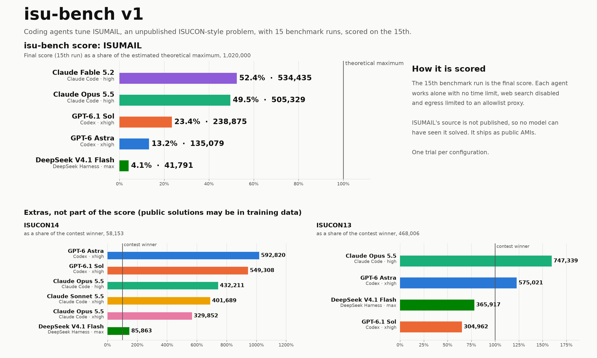

# isu-bench

English | [日本語](README.ja.md)

How far can a coding agent tune an ISUCON web service on its first encounter, given exactly 11 benchmark runs?

v1.1 is scored on [ISUMAIL](#isumail), an ISUCON-style problem written for isu-bench whose source is not published, so no model can have seen it solved. The agent gets the docs, the reference implementation and SSH to three servers, and is scored on its 11th benchmark run. [ISUCON14](https://github.com/isucon/isucon14) and [ISUCON13](https://github.com/isucon/isucon13) results are kept as [extras](#extras-isucon14-and-isucon13), and the results of v1 are [below](#changes-from-v1). See [REQUIREMENTS.md](REQUIREMENTS.md) for the full rules and [prompt.md](prompt.md) for the exact prompt.

## Results

Interactive charts of every run: [isu-bench.trasta.dev](https://isu-bench.trasta.dev/)

**isu-bench score** is the final ISUMAIL score divided by its estimated theoretical maximum, 1,060,000. Language Go. Every trial used all 11 benchmark runs and passed the post-reboot persistence check.

| agent | model | effort | isu-bench score | final | × initial | best | FAIL | uncounted | agent time | output tokens | cache read tokens | API cost |
|---|---|---|---:|---:|---:|---:|---:|---:|---:|---:|---:|---:|
| Claude Code 2.1.321 | claude-opus-5-5 | high | **43.2%** | 458,137 | 263 | 487,230 | 1 | 0 | 133 min | 289,271 | 66.1M | $22.78 |
| Codex 0.166.0 | gpt-6.1-sol | xhigh | **15.2%** | 161,341 | 93 | 175,262 | 1 | 0 | 45 min | 76,229 | 13.5M | $2.38 |
| Codex 0.166.0 | gpt-6-astra | xhigh | **9.7%** | 103,221 | 59 | 104,112 | 1 | 0 | 45 min | 68,381 | 9.2M | $13.72 |
| DeepSeek Harness 0.2.1-rc.5 | deepseek-v4.1-flash:1017 | max | **0.8%** | 8,279 | 5 | 8,450 | 6 | 0 | 47 min | 147,356 | 22.2M | $0.42 |

<details><summary>Scores of all 11 runs</summary>

| model | effort | runs |
|---|---|---|
| claude-opus-5-5 | high | 1,915, 336,358, FAIL, 400,880, 274,280, 449,916, 487,230, 462,396, 476,084, 462,168, 458,137 |
| gpt-6.1-sol | xhigh | 1,860, 4,756, 25,963, 74,373, 76,652, FAIL, 175,262, 89,290, 152,024, 165,383, 161,341 |
| gpt-6-astra | xhigh | 1,845, 5,088, 6,266, 38,481, FAIL, 37,457, 75,097, 97,471, 104,112, 102,418, 103,221 |
| deepseek-v4.1-flash:1017 | max | 1,718, FAIL, FAIL, FAIL, FAIL, FAIL, 5,436, 7,392, FAIL, 8,450, 8,279 |

</details>

- The reference implementation (`initial`) scores 1,744, the median of 5 `calibrate` runs (coefficient of variation 5.1%; all passed persist-check).
- API cost prices each trial's tokens at the providers' list prices on 2026-11-03, Anthropic's on 2026-11-10 ([isubench/prices.py](isubench/prices.py); DeepSeek at its peak rate, off-peak is half).
- Only `result.json` of each ISUMAIL trial is committed. Transcripts, workspace diffs and benchmark output contain the source and stay local.

### Changes from v1

- 11 benchmark runs instead of 15.
- ISUMAIL has a new benchmarker, in a new AMI of the benchmark host. The publishers of its scenario now act the same in every run, and the load was calibrated again so that the strongest implementations have further to go. The specification, the reference implementation and the other AMIs are the same.
- The theoretical maximum was estimated again: 1,060,000 (1,020,000 in v1).
- Scores of v1 and v1.1 cannot be compared. `isumail-v1` in [isubench/problems.py](isubench/problems.py) is the problem as it was.

<details><summary>Results of isu-bench v1 (15 runs)</summary>



**isu-bench score** is the final ISUMAIL score divided by its estimated theoretical maximum, 1,020,000. Language Go. Every trial used all 15 benchmark runs and passed the post-reboot persistence check.

| agent | model | effort | isu-bench score | final | × initial | best | FAIL | uncounted | agent time | output tokens | cache read tokens | API cost |
|---|---|---|---:|---:|---:|---:|---:|---:|---:|---:|---:|---:|
| Claude Code 2.1.321 | claude-fable-5-2 | high | **52.4%** | 534,435 | 248 | 549,184 | 0 | 0 | 409 min | 1,229,311 | 157.0M | $122.26 |
| Claude Code 2.1.316 | claude-opus-5-5 | high | **49.5%** | 505,329 | 235 | 513,920 | 1 | 0 | 138 min | 325,625 | 72.1M | $25.26 |
| Codex 0.166.0 | gpt-6.1-sol | xhigh | **23.4%** | 238,875 | 111 | 244,371 | 1 | 0 | 73 min | 93,841 | 15.8M | $2.81 |
| Codex 0.166.0 | gpt-6-astra | xhigh | **13.2%** | 135,079 | 63 | 135,079 | 2 | 1 | 74 min | 87,471 | 16.2M | $23.52 |
| DeepSeek Harness 0.2.1-rc.5 | deepseek-v4.1-flash:1017 | max | **4.1%** | 41,791 | 19 | 43,054 | 5 | 1 | 74 min | 235,222 | 37.6M | $0.64 |

<details><summary>Scores of all 15 runs</summary>

| model | effort | runs |
|---|---|---|
| claude-fable-5-2 | high | 1,878, 111,304, 494,406, 546,695, 523,085, 521,990, 526,397, 528,959, 522,380, 526,941, 530,877, 542,267, 538,386, 549,184, 534,435 |
| claude-opus-5-5 | high | 2,046, 438,146, FAIL, 475,462, 485,090, 473,317, 469,590, 497,013, 511,590, 503,614, 497,994, 513,920, 503,213, 509,469, 505,329 |
| gpt-6.1-sol | xhigh | 2,069, 4,953, FAIL, 74,129, 114,969, 149,435, 157,324, 194,707, 178,893, 184,809, 244,371, 236,080, 230,362, 244,164, 238,875 |
| gpt-6-astra | xhigh | 2,136, FAIL, 32,749, FAIL, 45,873, 55,941, 54,433, 81,842, 76,904, 116,076, 116,919, 127,762, 122,236, 131,060, 135,079 |
| deepseek-v4.1-flash:1017 | max | FAIL, FAIL, 10,244, FAIL, 33,360, FAIL, 18,339, 42,760, FAIL, 41,052, 42,678, 39,756, 39,640, 43,054, 41,791 |

</details>

- The reference implementation (`initial`) scores 2,153, the median of 5 `calibrate` runs (coefficient of variation 5.9%; all passed persist-check).

</details>

## ISUMAIL

ISUMAIL is a newsletter delivery service. Publishers schedule issues, and at the scheduled time the service renders each subscriber's copy and hands it to an external mail provider, which requires a proof-of-work stamp per mail and keeps a reputation per sending server; every issue has a delivery deadline. Readers open, click, share, unsubscribe and change their preferences, and new readers subscribe from shared public pages. The three servers differ in CPU architecture, speed and memory, the shared PostgreSQL starts on s1, and all traffic between the servers, the provider and the benchmarker goes through a router that limits each server's outgoing bandwidth. The score counts mail delivered in time and the readers' and publishers' activity. After the last run the servers are rebooted and a persistence check compares data written during that run.

The source (reference implementation, benchmarker, data generator and specification) is not published, to keep it out of training data. It ships in public AMIs instead; at the start of a run the harness copies `webapp/` and `docs/` from s1 as booted into the agent's workspace, and the benchmarker is the binary `/opt/isumail/bin/bench` on the benchmark host.

| role | AMI | instance | architecture |
|---|---|---|---|
| s1 (PostgreSQL, `isumail.test`) | `ami-0c07931bc35138ebf` (isumail-app-x86) | c5.large (2 vCPU, 4 GiB) | x86_64 |
| s2 | `ami-0386de926573364e3` (isumail-app-arm64) | c7g.medium (1 vCPU, 2 GiB) | arm64 |
| s3 (`t.isumail.test`) | `ami-0386de926573364e3` (isumail-app-arm64) | c6g.medium (1 vCPU, 2 GiB) | arm64 |
| router (no agent access) | `ami-0cc8249ffb25653a1` (isumail-router-arm64) | c6g.medium | arm64 |
| benchmark host | `ami-06ede16f4cb5d89d5` (isumail-bench-arm64; v1: `ami-026c9e398c9d0e68e`) | c7g.2xlarge | arm64 |

The AMIs are in ap-northeast-1. EC2 cost is about $0.64 per hour per run (instances $0.60, plus EBS and public IPv4), 13 vCPU.

What the harness does differently for ISUMAIL, all through the problem definition so ISUCON14 and ISUCON13 run as before:

- Fixed private addresses, a router instance with one address per server, and security groups without any app-to-app rule, so the router is the only path between the servers. The harness compares the security groups, interfaces and routes with the definition through the AWS API.
- The agent's SSH goes through the sidecar proxy with a 100 ms one-way delay and 20 Mbit/s per server and direction, and is closed (open tunnels too) from the start of the last run until the post-reboot check ends.
- A run that fails because of the benchmark environment (benchmarker error, router or clock check, a lost benchmark host) is not counted, up to 5 per session.
- Each run writes its own state file; the post-reboot check passes only if all three servers rebooted, s1 answers `GET /api/me` with 401, and `bench persist-check` passes against the run ID and state hash of the last counted run.
- Before and after each run the harness checks the router's rules and the clocks (all hosts sync to Amazon Time Sync; more than 50 ms between the benchmark host and a server makes the run uncounted).

```sh
python3 -m isubench run --problem isumail --agent claude-code --model claude-opus-5-5 --effort high
python3 -m isubench calibrate --problem isumail -n 5                         # reference implementation, no agent
python3 -m isubench calibrate --problem isumail -n 5 --deploy solution.tar.gz  # another implementation
python3 -m isubench quota --problem isumail --trials 2
```

## Extras: ISUCON14 and ISUCON13

Not part of the isu-bench score: public solutions of these problems predate the models' training data. One trial per configuration, language Go, run under v1 with 15 runs. No run was lost to a benchmark host failure.

### ISUCON14

Contest winner 58,153. Initial Go implementation about 961 in this environment.

| agent | model | effort | final | of winner | × initial | best | FAIL | agent time | output tokens | cache read tokens | API cost |
|---|---|---|---:|---:|---:|---:|---:|---:|---:|---:|---:|
| Codex 0.166.0 | gpt-6-astra | xhigh | **592,820** | 1019% | 617 | 606,582 | 2 | 27 min | 56,487 | 11.7M | $15.93 |
| Codex 0.166.0 | gpt-6.1-sol | xhigh | **549,308** | 945% | 572 | 559,421 | 2 | 30 min | 67,379 | 11.4M | $2.24 |
| Claude Code 2.1.316 | claude-opus-5-5 | high | **432,211** | 743% | 450 | 477,541 | 1 | 41 min | 132,294 | 16.6M | $7.94 |
| Claude Code 2.1.316 | claude-sonnet-5-5 | xhigh | **401,689** | 691% | 418 | 401,689 | 2 | 67 min | 367,717 | 38.5M | $9.65 |
| Claude Code 2.1.316 | claude-opus-5-5 | xhigh | **329,852** | 567% | 343 | 353,166 | 3 | 80 min | 269,527 | 40.3M | $16.90 |
| DeepSeek Harness 0.2.1-rc.5 | deepseek-v4.1-flash:1017 | max | **85,863** | 148% | 89 | 90,099 | 2 | 34 min | 177,386 | 34.2M | $0.52 |

<details><summary>Scores of all 15 runs</summary>

| model | effort | runs |
|---|---|---|
| gpt-6-astra | xhigh | 873, 17,852, 66,152, 87,793, FAIL, FAIL, 270,371, 311,313, 435,930, 523,301, 559,514, 396,374, 606,582, 568,777, 592,820 |
| gpt-6.1-sol | xhigh | 1,048, 19,385, 41,712, 67,187, FAIL, 158,040, FAIL, 226,156, 326,604, 392,310, 403,436, 476,615, 526,064, 559,421, 549,308 |
| claude-opus-5-5 | high | 1,114, 324,523, 218,158, 329,892, 381,426, 404,605, 394,506, 448,640, 448,739, FAIL, 451,455, 452,172, 430,462, 477,541, 432,211 |
| claude-sonnet-5-5 | xhigh | 1,146, FAIL, FAIL, 384,734, 362,679, 284,013, 347,438, 84,960, 284,480, 366,121, 385,404, 398,708, 370,326, 385,127, 401,689 |
| claude-opus-5-5 | xhigh | 813, FAIL, 310,475, FAIL, 318,779, 330,011, 336,036, FAIL, 295,985, 346,503, 332,204, 353,166, 326,298, 333,172, 329,852 |
| deepseek-v4.1-flash:1017 | max | 874, FAIL, FAIL, 15,367, 24,127, 28,901, 39,520, 41,843, 35,748, 46,183, 45,897, 44,156, 74,162, 90,099, 85,863 |

</details>

### ISUCON13

Contest winner 468,006. Initial Go implementation about 3,673 in this environment.

| agent | model | effort | final | of winner | × initial | best | FAIL | agent time | output tokens | cache read tokens | API cost |
|---|---|---|---:|---:|---:|---:|---:|---:|---:|---:|---:|
| Claude Code 2.1.316 | claude-opus-5-5 | high | **747,339** | 160% | 203 | 754,691 | 0 | 53 min | 190,779 | 27.6M | $11.99 |
| Codex 0.166.0 | gpt-6-astra | xhigh | **575,021** | 123% | 157 | 575,021 | 0 | 56 min | 97,641 | 13.7M | $20.42 |
| DeepSeek Harness 0.2.1-rc.5 | deepseek-v4.1-flash:1017 | max | **365,917** | 78% | 100 | 365,917 | 2 | 35 min | 178,577 | 27.9M | $0.43 |
| Codex 0.166.0 | gpt-6.1-sol | xhigh | **304,962** | 65% | 83 | 304,962 | 0 | 44 min | 82,342 | 13.1M | $2.78 |

<details><summary>Scores of all 15 runs</summary>

| model | effort | runs |
|---|---|---|
| claude-opus-5-5 | high | 3,723, 230,021, 221,043, 337,855, 477,198, 493,427, 542,039, 560,897, 589,428, 681,111, 754,691, 746,398, 579,325, 738,742, 747,339 |
| gpt-6-astra | xhigh | 3,469, 26,064, 118,297, 227,842, 301,325, 288,811, 352,448, 383,837, 417,636, 398,742, 531,668, 554,338, 566,163, 574,161, 575,021 |
| deepseek-v4.1-flash:1017 | max | 3,585, FAIL, FAIL, 182,912, 172,140, 206,389, 333,473, 323,039, 325,788, 298,248, 328,300, 322,722, 337,906, 361,742, 365,917 |
| gpt-6.1-sol | xhigh | 3,673, 22,002, 43,549, 69,009, 188,766, 238,026, 270,845, 271,524, 247,858, 273,322, 294,266, 274,967, 301,968, 291,157, 304,962 |

</details>

Raw benchmark logs, agent transcripts, proxy logs and workspace diffs of these problems are in [results/](results/). `python3 -m isubench table` prints all results from `results/*/result.json`.

## Rules

- The agent runs `bench` at most 11 times. Every run counts, including failures, and the session ends when the 11th finishes. Only a lost benchmark host (not a failing application) is not counted; for ISUMAIL also a run the benchmark environment broke (above).
- Score = the 11th run's score. A FAIL scores 0.
- The harness then reboots the three servers; if the application does not respond, the score is 0.
- If the agent stops early, it is resumed up to 3 times with "Continue. N of 11 benchmark runs remain."
- No wall-clock limit, and the prompt says so.
- Web search tools are disabled and all traffic goes through an allowlist proxy (model API, package registries, SSH to the servers).

## Running

Requirements: Linux with Docker, the AWS CLI v2 with credentials for ap-northeast-1 (13 vCPU of on-demand C instances per ISUMAIL run, 14 for ISUCON14 and ISUCON13), Python 3.10+, git and ssh.

```sh
export ANTHROPIC_API_KEY=...   # or CLAUDE_CODE_OAUTH_TOKEN / OPENAI_API_KEY / DEEPSEEK_API_KEY / OLLAMA_API_KEY
python3 -m isubench run --problem isumail --agent claude-code --model claude-opus-5-5 --effort high
python3 -m isubench table
```

Problems: `isucon14` (default), `isucon13` and `isumail`, chosen with `--problem`. Agents: `claude-code`, `codex`, `dsh` (DeepSeek Harness). `--effort` is required so every result records the reasoning effort it ran with; `--lang` switches the initial implementation (`go`, `rust`, `node`, `perl`, `php`, `python`, `ruby`).

- Codex can also use a ChatGPT login made for isu-bench only: `docker run --rm -it -v ~/.config/isu-bench/codex:/home/agent/.codex isu-bench-agent:v1 codex login --device-auth`.
- `dsh` with `OLLAMA_API_KEY` runs against Ollama Cloud. The proxy sidecar holds the key and adds it to each request, so the agent container never sees it.

A run creates its own VPC, security groups, key pair and four instances (five for ISUMAIL), and deletes them when it ends. If the harness dies, the instances terminate themselves after 48 hours; `python3 -m isubench teardown <run_id>` deletes everything right away.

EC2 cost is about $0.64 per hour per ISUMAIL run and $0.75 for ISUCON14 and ISUCON13 (three c5.large and one c5.2xlarge in ap-northeast-1), plus model usage.

## Limitations

- One trial per configuration because of EC2 cost; variance between trials is not measured.
- Public ISUCON14 and ISUCON13 solutions predate the models' training data, which is why they are extras. The harness blocks web access during the run, not prior knowledge.
- For ISUCON14 and ISUCON13 the post-reboot check confirms that the service responds, not that written data survived (ISUMAIL compares the data).
- Token counts come from each CLI's transcripts and are not strictly comparable across providers. Input means uncached input.
- dsh's command timeout is raised from 60 s to 10 min because one benchmark run takes about 70 s.
- The benchmark host has 16 GiB instead of the contest's 8 GB, because the benchmarker ran out of memory at 8 GiB when an application stalled.

## Credits

- [ISUCON2026](https://isucon.net/), whose problem ISUMAIL's design draws on heavily.
- [isucon/isucon14](https://github.com/isucon/isucon14) for the problem, reference implementations and benchmarker.
- [matsuu/aws-isucon](https://github.com/matsuu/aws-isucon) for the AMI.
- [kyosu-1/isuenv](https://github.com/kyosu-1/isuenv) for the TTL technique.

## License

[MIT](LICENSE)
