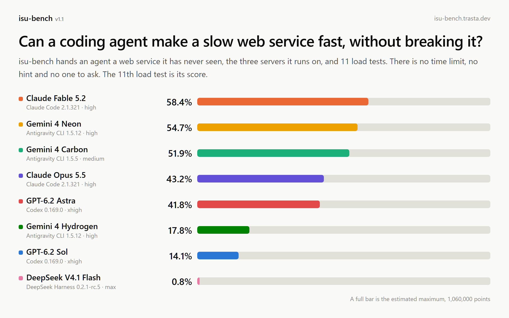

# isu-bench

English | [日本語](README.ja.md)

**Can a coding agent make a slow web service fast, without breaking it?**

isu-bench hands an agent a web service it has never seen, the three servers it runs on, and 11 load tests. There is no time limit, no hint and no one to ask. The 11th load test is its score.

Charts and every number: **[isu-bench.trasta.dev](https://isu-bench.trasta.dev/)**



## Results

isu-bench v1.1. The score is the 11th load test as a share of the estimated maximum, 1,060,000 points. One trial per configuration, in Go.

| Model | Agent | Effort | Score | Points | Time | API cost | Failed tests |
|---|---|---|---:|---:|---:|---:|---:|
| Claude Fable 5.2 | Claude Code 2.1.321 | high | **58.4%** | 619,552 | 4 h 31 min | $76.55 | 0 / 11 |
| Gemini 4 Carbon | Antigravity CLI 1.5.5 | medium | **51.9%** | 550,562 | 3 h 9 min | $39.27 | 2 / 11 |
| Claude Opus 5.5 | Claude Code 2.1.321 | high | **43.2%** | 458,137 | 2 h 13 min | $22.78 | 1 / 11 |
| GPT-6.2 Astra | Codex 0.169.0 | xhigh | **41.8%** | 442,954 | 35 min | $9.70 | 1 / 11 |
| GPT-6.1 Sol | Codex 0.166.0 | xhigh | **15.2%** | 161,341 | 46 min | $2.38 | 1 / 11 |
| GPT-6.2 Sol | Codex 0.169.0 | xhigh | **14.1%** | 149,916 | 48 min | $4.14 | 1 / 11 |
| GPT-6 Astra | Codex 0.166.0 | xhigh | **9.7%** | 103,221 | 46 min | $13.72 | 1 / 11 |
| DeepSeek V4.1 Flash | DeepSeek Harness 0.2.1-rc.5 | max | **0.8%** | 8,279 | 48 min | $0.42 | 6 / 11 |

- The untouched service scores about 1,744 points (0.2%), the median of 5 runs, and varies by about 5% from run to run.
- Every trial used all 11 load tests and kept its data through the reboot that follows the last one.
- API cost prices each trial's tokens at the provider's list price in November 2026 ([isubench/prices.py](isubench/prices.py)). DeepSeek is at its peak rate, and Gemini 4 Carbon at its introductory price, which doubles on 2026-12-01.
- Gemini 4 Carbon ran in Antigravity CLI on a Gemini API key, at `medium` of the three efforts it offers. The key's credit ran out after the 7th load test and the session went on with a second key, as one of its three resumes.
- The score of each load test and the tokens of each trial are on the [site](https://isu-bench.trasta.dev/). `python3 -m isubench table` prints them from `results/*/result.json`.

## The task

The agent takes the seat of a contestant in a performance tuning contest. It starts with:

- the specification of ISUMAIL, a newsletter delivery service, written in Japanese
- a reference implementation in Go and PostgreSQL that works but is slow
- root access to the three servers it runs on, which differ in CPU and memory

**Anything may change**: queries and indexes, caching, the architecture, the language, the database, which server does what. The only condition is that the service keeps behaving as the specification says.

A load test plays the users. Publishers schedule issues, which must reach every subscriber before a deadline; readers open, click, share and subscribe. The score counts the mail delivered in time and the activity that succeeded. Inconsistent data fails the test.

## What it measures

| | Test-based coding benchmarks | isu-bench |
|---|---|---|
| The work | Change the code in a repository | Run a live system: code, database and three servers |
| Done when | The tests pass | Never. Every improvement raises the score |
| Feedback | Run the tests as often as needed | 11 load tests, and failing the last one scores 0 |
| Prior exposure | Mostly public code | An unpublished problem, shipped only as machine images |

Doing well takes several skills at once:

- reading an unfamiliar specification and codebase
- finding the bottleneck by measuring it
- carrying a large rewrite through without breaking behavior
- operating servers: deployment, recovery after a reboot, durable data
- judgment under a budget: when to spend a load test, and when to stop taking risks

## Where the format comes from

The format is borrowed from [ISUCON](https://isucon.net/) (*Iikanji ni Speed Up Contest*, roughly "speed it up nicely"), a web performance tuning contest held in Japan since 2011. Teams of up to three engineers get the same deal: an unfamiliar slow service, a few servers and eight hours. The highest score at the end wins.

Past ISUCON problems and their solutions are public, so a model may have seen them solved. isu-bench is therefore scored on ISUMAIL, a problem in the same style written for it.

## ISUMAIL

ISUMAIL's source is not published: not the specification, the reference implementation, the benchmarker or the data generator. This repository says no more about how it works than the section above, and the derivation of the estimated maximum is withheld too, so that the problem stays out of training data.

- It ships as public machine images (AMIs) in ap-northeast-1. At the start of a trial the harness copies the specification and the reference implementation from a booted server into the agent's workspace.
- Only `result.json` of each ISUMAIL trial is committed. Transcripts, workspace diffs and benchmark output contain the source and stay local.
- A trial runs five EC2 instances (the three servers, a router and a benchmark host) for about $0.64 per hour. The AMIs and instance types are in [isubench/problems.py](isubench/problems.py).

## Rules

- The agent runs the load test with `bench`, at most 11 times. Every run counts, failed ones included, and the session ends when the 11th finishes.
- Score = the points of the 11th run. A FAIL scores 0.
- The harness then reboots the three servers. If the service does not come back with the data written during the last run, the score is 0.
- A run that the benchmark environment broke, not the application, is not counted, up to 5 per session.
- No time limit, and the prompt says so. An agent that stops early is resumed up to 3 times with "Continue. N of 11 benchmark runs remain."
- No web access. Search tools are disabled and all traffic goes through an allowlist proxy: the model API, package registries and SSH to the servers.
- SSH to the servers closes when the last run starts and stays closed until the reboot check ends.

The full rules are in [REQUIREMENTS.md](REQUIREMENTS.md) and the exact prompt in [prompt.md](prompt.md).

## Running

Requirements: Linux with Docker, the AWS CLI v2 with credentials for ap-northeast-1 (13 vCPU of on-demand C instances per ISUMAIL trial), Python 3.10+, git and ssh.

```sh
export ANTHROPIC_API_KEY=...   # or CLAUDE_CODE_OAUTH_TOKEN / OPENAI_API_KEY / DEEPSEEK_API_KEY / OLLAMA_API_KEY / GEMINI_API_KEY
python3 -m isubench run --problem isumail --agent claude-code --model claude-opus-5-5 --effort high
python3 -m isubench table
```

| Agent | `--agent` | Notes |
|---|---|---|
| Claude Code | `claude-code` | |
| Codex | `codex` | Can use a ChatGPT login made for isu-bench only: `docker run --rm -it -v ~/.config/isu-bench/codex:/home/agent/.codex isu-bench-agent:v1 codex login --device-auth` |
| Antigravity CLI | `agy` | Takes a Gemini API model by name (`--model gemini-4-carbon`) and `--effort low`, `medium` or `high`. Its web search runs inside the model API, past the proxy, so a hook denies it together with the browser and URL tools |
| DeepSeek Harness | `dsh` | With `OLLAMA_API_KEY` it runs against Ollama Cloud. The proxy sidecar holds the key, so the agent's container never sees it |

- `--effort` is required, so every result records the reasoning effort it ran with.
- A trial creates its own VPC, security groups, key pair and instances, and deletes them when it ends. If the harness dies, the instances terminate themselves after 48 hours; `python3 -m isubench teardown <run_id>` deletes everything right away.

```sh
python3 -m isubench calibrate --problem isumail -n 5                           # the reference implementation, no agent
python3 -m isubench calibrate --problem isumail -n 5 --deploy solution.tar.gz  # another implementation
python3 -m isubench quota --problem isumail --trials 2                         # is the vCPU quota enough?
```

## Earlier versions and other problems

- **v1** gave 15 load tests and used an earlier ISUMAIL benchmarker, so v1 and v1.1 scores cannot be compared. Its results are in `results/` and in [the v1 figure](docs/isu-bench-v1.png).
- **ISUCON14 and ISUCON13** also run in the harness (`--problem isucon14`, `--problem isucon13`, with `--lang` for the starting language). Agents were run on both under v1. They are not part of the score, because public solutions of these problems predate the models' training data. Their results, benchmark logs and transcripts are in `results/`.

## Limitations

- Each configuration ran once because of the EC2 and API cost, so the spread between trials is not measured. Small gaps mean little.
- Each model runs in its vendor's own agent, so a result belongs to the pair, not to the model alone.
- The maximum is an estimate of the problem's theoretical limit.
- Token counts come from each agent's transcripts and are not strictly comparable across providers. Input means uncached input.
- DeepSeek Harness's command timeout is raised from 60 seconds to 10 minutes, because one load test takes about 70 seconds.

## Credits

- [ISUCON2026](https://isucon.net/), whose problem ISUMAIL's design draws on heavily.
- [isucon/isucon14](https://github.com/isucon/isucon14) for the problem, reference implementations and benchmarker.
- [matsuu/aws-isucon](https://github.com/matsuu/aws-isucon) for the AMI.
- [kyosu-1/isuenv](https://github.com/kyosu-1/isuenv) for the TTL technique.

## Trademark

ISUCON is a trademark or registered trademark of SAKURA internet Inc. ([isucon.net](https://isucon.net))

isu-bench is an independent project. It is not run, sponsored or endorsed by the ISUCON organizers or SAKURA internet Inc.

## License

[MIT](LICENSE)
